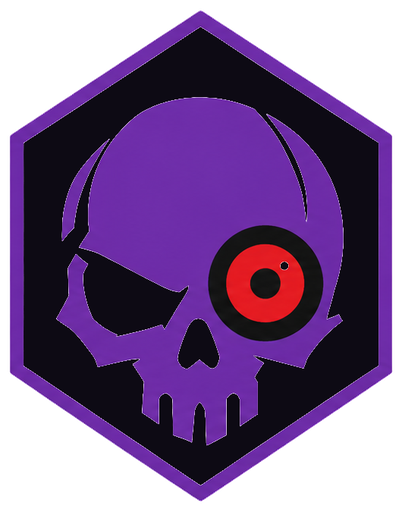
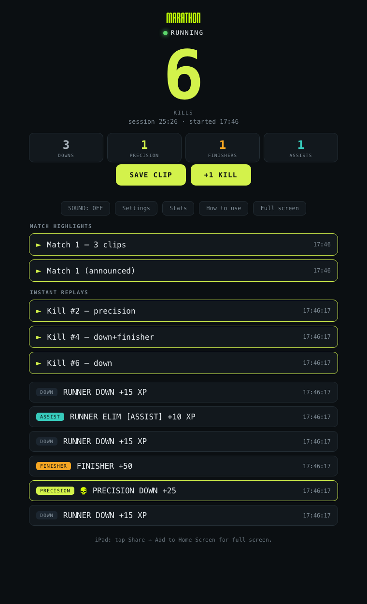
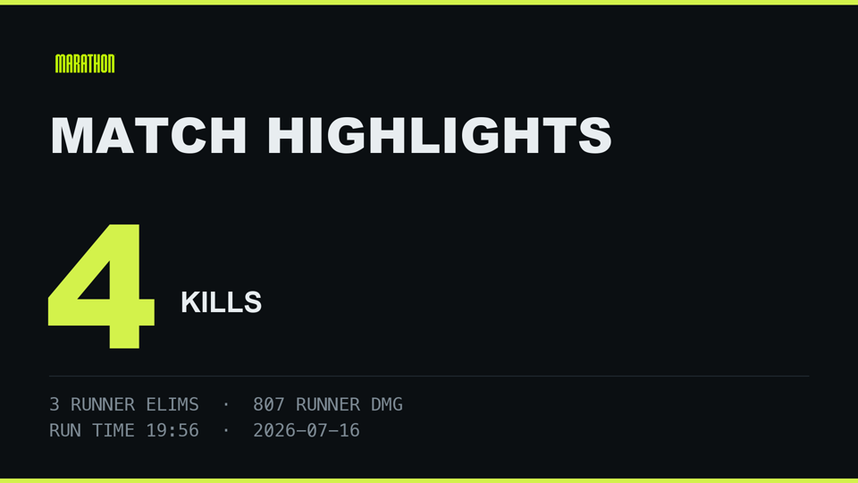
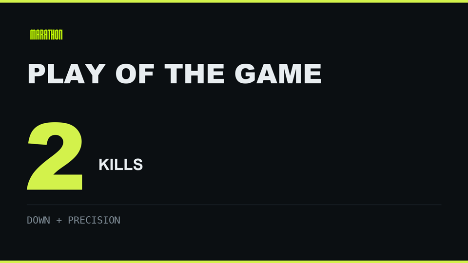
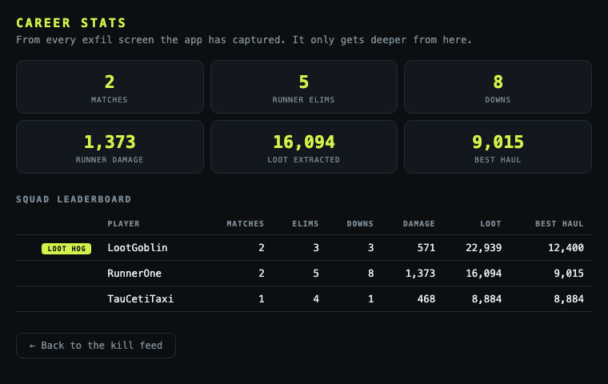
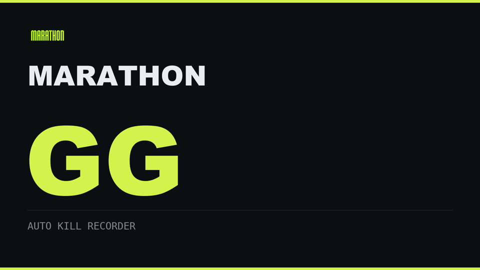

# WITNESS



**It sees everything.** WITNESS automatically clips every kill you get in
Bungie's **Marathon** and turns each match into a highlight reel. It can also
be taught other games with a text kill popup (experimental).

**At a glance:** Windows 10/11 · OBS 28+ · NVIDIA GPU recommended (AMD or no
GPU uses CPU OCR and misses some fast popups) · first install downloads
several GB (PyTorch) · 16:9 display, ultrawide untested · free, MIT ·
unofficial fan tool, not affiliated with Bungie.

**New here? Follow [QUICKSTART.md](QUICKSTART.md)**: zero to auto-clipped
kills in about 15 minutes, no coding.

## FAQ

**Can this get me banned?** It only reads the picture on your screen and
controls OBS, the same way OBS or ShadowPlay read the screen. It does not
read or write game memory, inject code, or send input. That is not a
promise: neither Bungie nor any anti-cheat vendor has reviewed it, and nobody
can guarantee their policies. Use it at your own discretion. Lower-exposure
setups are in the [Anti-cheat note](#anti-cheat-note).

**Will it cost me FPS?** It OCRs one small screen region about 5 times a
second, on the GPU when it can. Reels render at low priority after a match
or after you stop. Don't take our word for it: double-click
`4 - Benchmark (will my PC handle it).bat` (or press **Benchmark** in the
dashboard) for a number from your own PC. See [Performance](#performance-will-my-pc-handle-it).

**Do I need an NVIDIA card?** Recommended, not required. GTX 16-series /
RTX 20-series and newer run OCR on the GPU. GTX 10-series and older, AMD,
Intel or no GPU fall back to the CPU: it works, but catches slightly fewer
split-second popups.

**How big is it?** The first setup downloads several GB, mostly PyTorch for
the OCR engine. Clips are whatever your OBS Replay Buffer saves.

**Why .bat files? Windows says "Windows protected your PC."** The .bat files
are plain text: open one in Notepad and read it before you run it. The ZIP isn't code-signed, so SmartScreen warns about files that came
from the internet. Click **More info → Run anyway**, or before you extract,
right-click the ZIP → *Properties* → tick **Unblock**. What each file does:
[What's in the folder](#whats-in-the-folder).

**Does it update itself? What does that run?** Yes. Every launch checks this
repo's `main` branch and runs whatever is there. Turn it off with
`auto_update: false`; see [Security and privacy](#security-and-privacy).

**What leaves my PC?** The update check, the Microsoft neural voice for
reels and the WITNESS Report (on by default, `tts_online: false` turns it
off), and anything you opt into (ElevenLabs, YouTube). No telemetry. Full
list in [Security and privacy](#security-and-privacy).

**Was this made with AI?** Yes: it was built with Claude Code. The automated
tests are in [`tests/`](tests/).

## What it looks like

**The live dashboard** (the WITNESS window on your PC, and Safari or Chrome on
any phone/iPad on your Wi-Fi): kill counter, breakdown, instant replays you
can tap seconds after the kill, per-match highlight reels, and a +1 button
for anything the detector misses:



**Highlight reels** open on a stat card, lead with your Play of the Game, and
close with a GG: music bed, crossfades, kill chyrons, and an optional
announcer voiceover:




**Career + squad stats**, parsed straight off the exfil screens, including
your teammates. The squad's top extractor wears the crown. The **Menace
Report** reads gamertags off the kill feed: who you've downed (with a
"last downed" timestamp for repeat offenders) and who's been downing you.
It needs `gamertag` set in config.yaml to your exact in-game name:





**Every session, kept.** The Archive lists every past session with per-match
recaps and one-tap access to all its reels and clips. "save" downloads any of
them to share:


Marathon has no public kill API, so this tool *watches your screen*: it OCRs
the center-screen reward popup that appears only on your downs
(**"RUNNER DOWN +15 XP"**, **"FINISHER +50"**, **"PRECISION DOWN +25"**). On
each kill it saves OBS's **Replay Buffer** as a clip, bumps a counter, and
feeds a live dashboard you open on an iPad/phone.

```
screen -> OCR -> detector -> OBS replay save -> clips, reels, shorts, dashboard
```

## What you get

- **Auto clips**: every kill saved by OBS; back-to-back down+finisher get
  grouped into one clip (`kill_coalesce_seconds`).
- **Live dashboard**: kill counter, feed, kill ding, manual SAVE CLIP
  button, instant replays (tap any kill to rewatch it seconds later), and a
  settings panel. The WITNESS window shows the address to open on a phone
  or iPad on the same Wi-Fi.
- **iPad/iPhone app (optional)**: a companion app in [`ios/`](ios/README.md)
  finds the PC by itself, plays your clips and reels, and alerts you if OBS
  is recording a black screen. You build it with Xcode on a Mac; a free
  Apple ID works. The Safari dashboard keeps working without it.
- **Match highlight reels**: when the EXFILTRATED screen appears, the match's
  clips become an ESPN-style reel: stat title card, **Play of the Game**
  (your biggest clip leads), optional music bed, and an optional second
  version with an announcer voiceover. It pops up on the iPad automatically.
- **Exfil stat capture**: the summary screen is OCR'd and logged to
  `stats/match_stats.csv`, with an audit line comparing the game's kill count
  to what was detected. The screen itself is saved as a PNG.
- **Vertical Shorts**: each clip also renders as a 1080x1920 short (blurred
  background, centered gameplay, a label with the event tag such as
  "DOWN + FINISHER" and the game name), upload-ready.
- **Session recap**: montage, shareable match-card PNG, Play of the Night
  (the single best clip of the session, cut into its own reel), and an HTML
  recap at session end. Closed the app mid-build? It finishes at next launch.
- **Clip viewer**: the **Clips** page lists a session's clips; pick some and
  press **Export reel** to cut your own reel into the session's `reels/`.
- **Tight cuts**: reels start seconds before each kill, not 30 seconds of
  buffer lead-in. Kill timing is recorded with every clip.
- **Scoreboard-checked counting**: the exfil screen's own numbers check the
  kill count every match, and downs or Runner Elims the detector missed are
  credited from the game's panel. Double kills count as two (stacked popups
  are counted, not just seen).
- **Killstreaks**: FIRST BLOOD, HEATING UP, ON FIRE, RAMPAGE, MENACE, APEX,
  plus SHARPSHOOTER for precision chains: on-screen toasts, voiced call-outs,
  and a live streak chip on the dashboard. Streaks persist until you die.
- **The WITNESS Report**: an end-of-night dossier in the app's ominous
  narrator voice: confirmed kills, prime target, standing threat, verdict.
  Shown in the Archive and spoken over the session reel's intro.
- **W/L record**: EXFILTRATED vs ELIMINATED is read off the summary screen:
  survival rate, deaths, and your best exfil streak on the Stats page.
- **Menace Report**: who you've downed and who keeps downing you, gamertags
  read straight off the kill feed, with MENACED / NEMESIS callouts.
- **Modes**: one-tap bundles in Settings (SWEAT, STANDARD, SHOWTIME,
  CREATOR). A mode is a starting point; every toggle stays adjustable.
- **Safety checks**: WITNESS checks OBS's picture at START and every few
  minutes, and warns loudly ("OBS IS BLACK") if your clips would be empty. A
  detection canary compares the game's exfil numbers with what was detected
  and says so if detection looks broken, instead of failing silently.
- **Detection health**: a live fps/VRAM readout and a one-click Benchmark
  that measures OCR speed on your machine and tells you the headroom.

## Any game (experimental): teach it your game

Marathon is the home game and the only game that ships with a profile. The
engine can be taught other games that show a **text** kill popup.
Double-click **`Teach a Game.bat`** (or run
`.venv\Scripts\python main.py --teach`):

Name the game, alt-tab in, get a kill inside 90 seconds. The wizard reads
everything on screen, ranks the popup-like lines, asks which one was your
kill, and measures the trigger phrase, screen region and reward marker.
Then it **verifies**: get one more kill and it watches the region it just
measured with the real detector and tells you whether it fired. If it
didn't, it shows what it actually read there, so you know whether the
region or the phrase was wrong. You find out in 45 seconds instead of
after a wasted session. Bot matches and practice ranges are perfect for this.

**Get two or three kills during the watch, not one.** Many games print the
victim's name in the popup ("KNOCKED DOWN xXTTVGamerXx"); seeing it fire on
different players is how the wizard knows which words repeat and which are
just somebody's name. With a single kill it can't tell, and it will say so.

A profile (`games/<game>.yaml`) can only set detection, theme and
feature-gate keys. Anything else in it (paths, an `obs:` block, upload or
dashboard settings) is ignored, and the console names the keys it ignored.
Still, read a profile someone else sends you before you use it. To share
yours, PR your `games/<game>.yaml` and everyone gets that game.

**What a taught game gets today:** kill detection, auto-clips, the counter,
the live dashboard, killstreaks, session reels and Play of the Night,
Shorts, and its own colors. **What it doesn't:** per-match reels and the
other systems that read Marathon's specific screens (exfil stats, W/L
outcomes, the Menace Report, runner detection) stay off until that game's
screens are mapped. The wizard learns kill popups; it does not yet learn
scoreboards. Other games have their own anti-cheat rules; the
[Anti-cheat note](#anti-cheat-note) is about Marathon.

## Console players?

Yes, with a capture card and any spare PC. The whole pipeline just reads a
video feed: console -> HDMI capture card (passthrough to your TV, zero
added latency) -> a PC running OBS + this app. Detection, clips, reels,
stats and the phone dashboard all work. On-screen toasts draw on the PC
monitor, not your TV. The PC doesn't need to be a gaming rig (the console
renders the game); anything that passes the Benchmark works. A cheap USB
HDMI grabber is enough, because the popup text is large. In OBS,
right-click the capture-card source -> Fullscreen Projector on the monitor
this app watches.

Without a PC anywhere in the chain there's nothing we can do: no code can
run on the console itself.

## Anti-cheat note

This tool never touches the game: it does **not** read game memory, inject
code, hook APIs, or send any input. It only reads the *picture* on screen and
controls OBS, the same category as OBS, ShadowPlay, or Medal.tv. For lower
exposure, set `capture_source: obs_virtualcam` so this tool only reads OBS's
Virtual Camera instead of grabbing the screen itself. The most conservative
setup is a second PC fed by a capture card, so nothing runs on the gaming PC
at all. No guarantees about Bungie's policies: use at your own discretion.

## Security and privacy

WITNESS reads your screen and controls OBS, so it documents itself rather
than asking for trust. [SECURITY.md](SECURITY.md) has the details and the
commands to check them yourself. The short version:

- **What leaves your PC:**
  - the update check to this GitHub repo, every launch while
    `auto_update` is on;
  - **Microsoft Edge neural TTS** (via edge-tts), on by default whenever the
    announcer speaks: reel voiceovers, the WITNESS Report, and call-outs if
    you turn them on. It sends the text being spoken, which includes your
    `announcer_player_name` and can include other players' gamertags. Set
    `tts_online: false` to use the offline Windows voice instead;
  - **ElevenLabs**, only if you add your own API key;
  - **YouTube**, only if you set up your own Google OAuth app and turn on an
    upload toggle.

  First-time setup also downloads packages and the OCR model. No telemetry,
  no accounts, no analytics.
- **Auto-update runs code from this repo.** That's what an auto-updater is:
  whatever lands on the `main` branch runs on your PC at next launch. If you
  don't want that trust relationship, set `auto_update: false`, read the new
  commits on GitHub, then double-click **Update WITNESS.bat** when you're
  happy with them. The launch check and the dashboard's update button stay
  off while `auto_update` is false.
- **The dashboard has no password.** It serves on your local network so a
  phone/iPad can reach it; anyone on the same Wi-Fi can open it and press its
  buttons (start/stop, save clip, +1, rebuild, settings, including the
  YouTube upload toggles). Web pages from other sites can't drive it:
  WITNESS refuses requests that don't name this PC, and button presses from
  another site's page. On shared or public Wi-Fi, set `web_lan: false` in
  config.yaml: the dashboard then answers only on this PC, and you lose the
  phone/iPad view.
- **Keep OBS WebSocket authentication on.** OBS listens on your network
  too; without a password, anyone on your Wi-Fi can control it.
- **Credentials stay local and out of git**: your OBS password lives in your
  local `config.yaml` (never overwritten by updates), and
  `client_secret.json` / `youtube_token.json` are gitignored.
- The dashboard serves only fixed assets and clips the app itself
  registered, and its session routes accept only real session folders, so
  requests can't reach arbitrary files. On-screen text is HTML-escaped.
- With `bonjour_discovery: true` (the default, only when `web_lan` is on),
  WITNESS announces itself on your local network so the iOS app can find it.
  It never leaves your LAN.

Found a security problem? [SECURITY.md](SECURITY.md) says how to report it.

## Requirements

- **Windows 10/11** PC (the game machine).
- **OBS 28+** (ships with obs-websocket v5).
- **Python 3.12 (64-bit)**; 3.10-3.12 work. 3.13 and newer are not
  supported yet (PyTorch/EasyOCR). [QUICKSTART](QUICKSTART.md) has the link.
- **A 16:9 display.** The screen regions were measured on 16:9. Ultrawide is
  untested: reels letterbox it, and exfil stats and kill-feed names may not
  read.
- **ffmpeg** for instant replays, reels, Shorts and voiced call-outs. Setup
  installs a fallback copy automatically (imageio-ffmpeg). If you have your
  own, it wins: `ffmpeg_path` in config.yaml, then `ffmpeg.exe` in the app
  folder, then ffmpeg on PATH.

## Performance: will my PC handle it?

Don't guess, **measure it on your machine**: double-click
`4 - Benchmark (will my PC handle it).bat`, or press **Benchmark** on the
dashboard's Live page (the console version is `python main.py --bench`).

It times the real capture+OCR loop and gives a verdict (run it with the game
open for the honest number). What the app actually costs while you play:

- **Per frame**: one small screen-region grab + one OCR pass, 5x/second.
  On a GPU that is light inference, a fraction of one frame's budget.
- **VRAM**: EasyOCR holds roughly 1-1.5 GB.
- **GPU OCR**: GTX 16-series / RTX 20-series and newer run OCR on the GPU.
  GTX 10-series and older fall back to CPU (it works, and the session log
  says so). Keep your NVIDIA driver current; RTX 50-series needs driver 570 or
  newer.
- **No GPU / AMD / Intel**: it still works on CPU, but expect it to catch
  slightly fewer split-second popups. Set `poll_fps: 3` and
  `ocr_upscale: 2` to lighten it.
- **Video work happens off the fight**: reels, Shorts, and montage
  encode at low priority at session end (and match reels about 30 s after
  each exfil). Clip recording itself is OBS's Replay Buffer, the thing you
  already run.

## 1. One-time OBS setup

1. **Capture source:** in the *Sources* panel click **+** → *Display Capture*
   (pick the monitor Marathon runs on) or *Game Capture*. Check that the OBS
   preview shows your screen: a new OBS scene is empty and records black.
2. **WebSocket:** *Tools → WebSocket Server Settings* → **Enable WebSocket
   server**. Keep **Enable Authentication** on, click **Show Connect Info**,
   and paste the password into `config.yaml` (`obs:` → `password:`).
3. **Replay Buffer:** *Settings → Output → Replay Buffer* → enable, about
   35 s max. Set a recording path (*Settings → Output → Recording*). WITNESS
   starts the buffer on launch.
4. **Counter text source (optional):** add a *Text (GDI+)* source named
   `KillCounter` to your scene for an on-stream counter.

## 2. Install

**Most people:** follow [QUICKSTART.md](QUICKSTART.md): download the ZIP,
extract it to a plain local folder (not OneDrive), and double-click
`START Kill Recorder (Window).bat`. The first run finds Python 3.12, creates
`.venv`, and installs everything, including the GPU build of PyTorch when
it finds an NVIDIA card.

**Developers / manual install:**

```bat
git clone https://github.com/svisnesky/WITNESS.git
cd WITNESS
py -3.12 -m venv .venv
.venv\Scripts\activate
REM NVIDIA only, and before requirements.txt (plain pip gets CPU-only PyTorch on Windows):
python -m pip install torch torchvision --index-url https://download.pytorch.org/whl/cu128
python -m pip install -r requirements.txt
```

> **Tesseract (experimental):** `ocr_engine: tesseract` saves GPU memory
> while running, but it is less accurate on Marathon's fonts and does not
> make the install smaller (setup installs EasyOCR and PyTorch either way).
> It needs the Tesseract program installed separately.

## 3. Configure

Edit `config.yaml`:

- `obs.password`: from OBS setup step 2.
- `gamertag`: your exact in-game name. It ships blank, which turns off the
  Menace Report, kill-name chyrons and streamer alerts; the console reminds
  you once.
- `announcer_player_name` (optional): how the announcer says your name.
- The popup region is stored as fractions of the screen
  (`detect_region_frac`), measured on 16:9, so it holds at 16:9 resolutions.
  Run `1 - Calibrate.bat` only if kills are missed.

Edited `config.yaml` while WITNESS is open? Press **STOP**, then **START**:
the window app re-reads it at every START. `web_port`, `web_lan` and
`web_dashboard` need WITNESS closed and reopened.

Feature toggles (reels, music, announcer, shorts, montage, coalesce window…)
can be changed **live from the dashboard's Settings panel**, with no restart
and no file editing. Dashboard changes persist to `settings_override.yaml`,
which wins over `config.yaml`.

The loud stuff ships **off**: the voiced medal call-outs ("DOUBLE KILL!"),
Shorts renders, and the session montage are opt-in. Flip them on in
Settings once you've decided you like the quiet version. The medal voices
are worth trying.

Optional: drop mp3s into a `music/` folder; each reel picks one at random.

## 4. Run

Double-click `START Kill Recorder (Window).bat` (or the desktop shortcut
from `Create Desktop Shortcut.bat`) and press **START**. It launches OBS for
you if needed (`obs.auto_launch`).

**On a phone or iPad:** the WITNESS window shows an address like
`192.168.x.x:8000` under its header. Open it in Safari or Chrome on the same
Wi-Fi, tap the page once (unlocks the kill ding), and play. If it won't
load: allow Python on **Private networks** when Windows Firewall asks, set
your Wi-Fi's network profile to Private, and turn off any VPN on the PC. The
dashboard's **How to use** button explains every feature in-app. Prefer an
app? See [`ios/`](ios/README.md).

**It keeps itself updated**: on every launch (window app or console) WITNESS
checks GitHub, downloads only the files that changed, installs any new
packages, and relaunches on the fresh code. If the download finishes after
the splash screen has closed, the dashboard says **RESTART WITNESS** to
apply it instead. Turn it off with `auto_update: false`; **Check for update**
on the dashboard and `Update WITNESS.bat` update on demand.

Test without OBS side effects:

```bat
python main.py --dry-run                 # full pipeline, OBS actions logged only
python main.py --test-image shot.png     # OCR a saved screenshot
python test_popup_sim.py                 # detector vs real popup text, no game needed
```

## What's in the folder

The numbers on the first four files are just sort order: none of them is a
required step.

| File | What it does | When to use it |
|------|--------------|----------------|
| `START Kill Recorder (Window).bat` | The app: control window plus the dashboard | Every time (the desktop shortcut runs this) |
| `START Kill Recorder.bat` | The same detector in a console window, log scrolling | If you want to watch the raw log |
| `Create Desktop Shortcut.bat` | Puts a WITNESS icon on your desktop | Once |
| `1 - Calibrate.bat` | Drag a box around the kill popup; saves the region (keeps a backup of the old file) | Only if kills are missed |
| `2 - Test Screenshot.bat` | OCRs a saved screenshot (drag it onto the file) | Checking detection without playing |
| `3 - Dry Run (test, saves nothing).bat` | Live detection that prints kills but saves no clips | A rehearsal before going live |
| `4 - Benchmark (will my PC handle it).bat` | Times capture + OCR on your PC | Before you set anything else up |
| `Diagnose Capture.bat` | Saves `diagnose_full.png` and `diagnose_region.png` and prints what OCR read | Kills missed, or the capture looks wrong |
| `Teach a Game.bat` | The teach-a-game wizard, verify step included | Another game (experimental) |
| `Check Voice.bat` | Checks your ElevenLabs key and voice | Your ElevenLabs voice isn't being used |
| `Check YouTube.bat` | Checks the YouTube setup; `--upload` posts a 3-second PRIVATE test | After [YOUTUBE.md](YOUTUBE.md) |
| `Rebuild Last Session.bat` | Re-renders reels, montage and Shorts from the saved clips | A session's recap failed |
| `Update WITNESS.bat` | Updates now, even with `auto_update: false` | After reading the new commits |
| `_env.bat` | Shared setup the others call | Never directly |

Rebuild, Update and Benchmark are also dashboard buttons: **Rebuild reels**
in the Archive, **Check for update** and **Benchmark** on the Live page.

Files you might open:

| File | What it is |
|------|------------|
| `config.yaml` | All settings, with comments. Updates never overwrite it. |
| `settings_override.yaml` | What you changed in the dashboard's Settings. Wins over `config.yaml`. |
| `games/<game>.yaml` | A game profile (detection, theme and feature gates). |
| `logs/session_*.log` | Everything a session printed. Attach it to a bug report. |
| `stats/match_stats.csv`, `stats/encounters.csv` | Per-match exfil stats; names from the kill feed. |
| `session_log.csv` | One row per kill. |
| `music/` | Your mp3s for the reel music bed (optional). |

## Where files go

Everything lands in your OBS recording folder:

```
Marathon Sessions/<date_time>/
  clips/001_down_19-25-19.mkv          clips (auto-named by event)
  clips/002_down+finisher_19-27-52.mkv
  exfil/exfil_19-31-02.png             each match's summary screen
  reels/match_1.mp4                    highlight reel (+ match_1_announced.mp4)
  replays/*.mp4                        phone/iPad-playable copies of each clip
  shorts/*.mp4                         vertical renders
  highlights_<session>.mkv             end-of-session montage
  session_reel.mp4                     end-of-session reel (title card + POTG)
```

Clips sit at the top of the session folder while you play and move into
`clips/` and `exfil/` when the recap finishes. Nothing is deleted. Set
`tidy_session_folder: false` to keep them flat.

Plus `stats/match_stats.csv` (per-match exfil stats), `stats/cards/` (match
cards), and `session_log.csv` in the app folder.

## YouTube auto-upload (optional)

Uploads are off by default. Setup is in [YOUTUBE.md](YOUTUBE.md); it includes
publishing your Google OAuth app. Skip that step and uploads stop after 7 days.

## Tuning / troubleshooting

- **Missed kills:** with a kill popup on screen, run `Diagnose Capture.bat`
  and look at `diagnose_region.png`. If the box misses the popup, run
  `1 - Calibrate.bat`. For a full night's record of what OCR read, set
  `debug_ocr: true` (set it back afterwards: it logs every frame with text).
  Add exact popup wording to `popup_trigger_phrases`. The exfil audit tells
  you when a match had misses.
- **False positives:** raise `popup_match_threshold`; add screen-specific words
  to `suppress_phrases` (NPC popups and the exfil screen are already covered).
- **No clips saved:** Replay Buffer enabled? Recording path set? WebSocket
  password right? WITNESS names the OBS problem it found when you press START.
- **"OBS IS BLACK":** your OBS scene has no visible capture source (see OBS
  setup step 1), or you use Game Capture and the game isn't running yet.
- **No replays, reels, Shorts or voiced call-outs:** ffmpeg wasn't found;
  START prints a line saying so. Run `START Kill Recorder (Window).bat` once
  so setup can install its fallback, or put `ffmpeg.exe` in the app folder.
- **Phone/iPad can't open the dashboard:** allow Python on Private networks
  in Windows Firewall, set the Wi-Fi to Private, and turn off any VPN on
  the PC.
- **The logo shows, then nothing / setup was interrupted:** run START again.
  If it keeps failing, delete the `.venv` folder and run START again.
- **Robotic announcer voice:** `tts_online: false`, no internet at render
  time, or the neural voice failed. The session log (`logs/session_*.log`)
  has an `[announcer]` line saying which. Reels still build.
- **Dashboard silent:** tap the page once after opening (browser autoplay
  rule), check the SOUND toggle.
- **Still stuck?** Open an issue at github.com/svisnesky/WITNESS/issues and
  attach `logs/session_*.log`. It contains gamertags, your Windows user name
  in file paths and your LAN address, so look it over first.

## Development

```bat
python -m pip install -r requirements-dev.txt
python -m pytest tests/ -q
```

The suite needs no GPU, no OBS and no game (a couple of tests want ffmpeg on
PATH). GitHub Actions runs it on Windows and Linux for every push to `main` and
every pull request.

Where the code lives:

| file | role |
|------|------|
| `main.py` | wires everything together; test/dry-run/bench modes |
| `gui.py` | the desktop window launcher (splash, START/STOP, update check) |
| `webserver.py` | the dashboard (feed, replays, reels, clips, settings, help) |
| `detector.py` | popup detection logic |
| `ocr.py` / `capture.py` | OCR engines / screen + virtual-cam capture |
| `obs_client.py` / `blackcheck.py` | obs-websocket / black-capture check |
| `exfil_stats.py` / `canary.py` | exfil screen OCR -> stats CSV + audit / detection canary |
| `match_reel.py` / `shorts.py` / `montage.py` | highlight reels / vertical Shorts / montage + ffmpeg lookup |
| `announcer.py` | announcer TTS: ElevenLabs if keyed, Microsoft Edge neural voice (online, `tts_online`), offline Windows voice fallback |
| `teach.py` / `teach_gui.py` | the teach-a-game wizard |
| `updater.py` | auto-update from this repo |
| `discovery.py` | Bonjour announcement for the iOS app |
| `test_popup_sim.py`, `tests/` | popup simulation + the test suite |

Bugs and ideas: github.com/svisnesky/WITNESS/issues.

## License and disclaimer

WITNESS is an unofficial, fan-made tool. It is not affiliated with or
endorsed by Bungie, Inc. Marathon is a trademark of Bungie, Inc. The code is
MIT licensed (see [LICENSE](LICENSE)).
